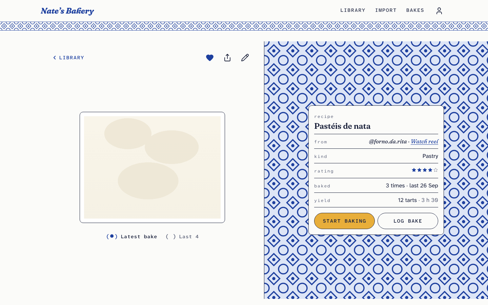
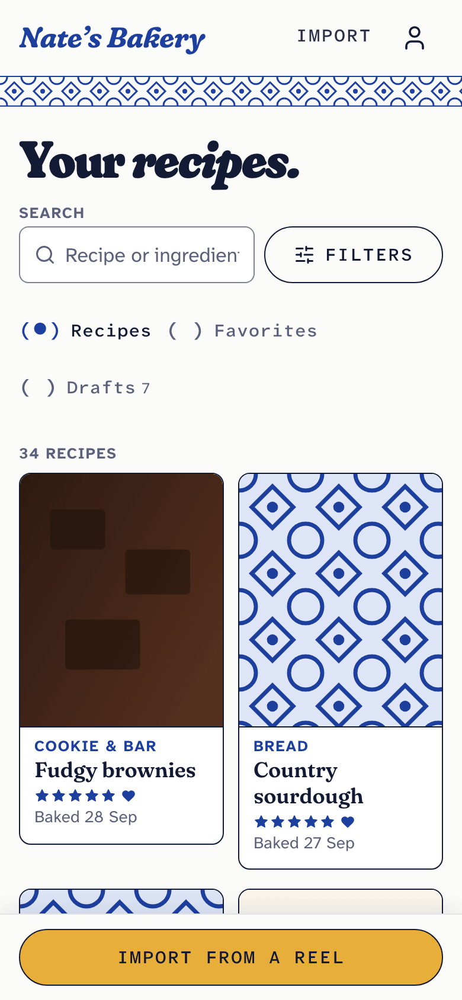
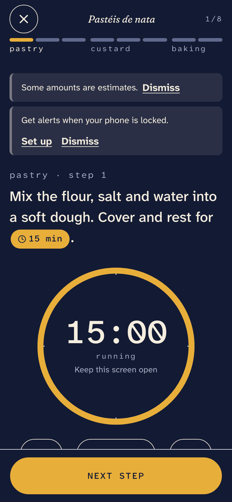
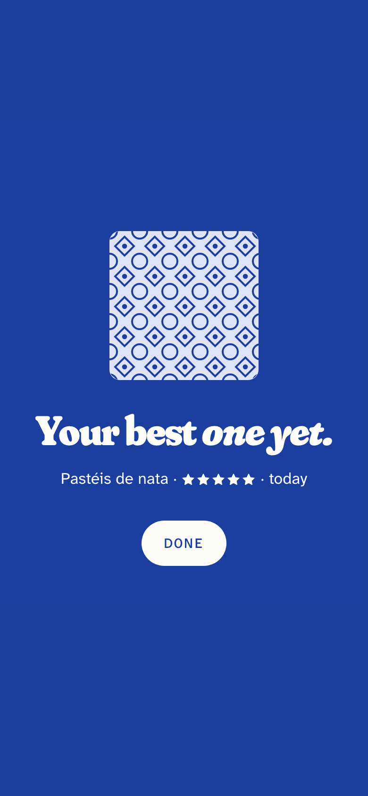

# Nate's Bakery

A personal baking notebook: save a recipe from an Instagram reel in two taps, read it in grams, bake it step by step, and keep a diary of every bake.

**Live:** [nates-bakery.vercel.app](https://nates-bakery.vercel.app) (one owner account; shared recipe links are public)



<p>
  
  
  
</p>

## What it does

- **Import from a reel.** Share a reel from Instagram to an iOS Shortcut. The caption is fetched, Apple Intelligence reads the recipe on the device, and a draft lands in the app with every amount converted to grams. Anything converted or estimated is flagged for a quick check before saving.
- **Read and scale.** Ingredients in grams on one shared right edge, scaled from ½× to 10×, with converted and estimated amounts marked in text, never by colour alone.
- **Bake Mode.** One step per screen on a dark stage: a giant step number, or a big clock when the step has a timer. Finished steps stack up as you go, timers keep running across steps, and the screen stays awake.
- **Log every bake.** Date, scale, a rating, how it turned out, what changed, and a photo that can become the recipe's cover. Milestones (a first bake, a best-ever rating, every fifth bake) get a small celebration.
- **A diary of bakes** grouped by month, and **share links** that let friends read and scale a recipe without seeing the owner's notes.

## How it was made

I'm a UX/UI and product designer. This app is my own, and it's also an experiment in designing a product spec-first and having an AI coding agent build it from those specs, with me reviewing every stage.

The design lives in plain Markdown, in three layers:

| File | Layer | What it decides |
|---|---|---|
| [`SKELETON.md`](SKELETON.md) | Structure | Routes, flows, navigation, what each page is for |
| [`BONES-*.md`](.) | Layout | A wireframe per page: sections, states, overlays, open questions, and a changelog of every decision |
| [`SKIN.md`](SKIN.md) | Design system | Tokens as YAML (colour, type, spacing, motion) plus the reasoning behind every component |

The theme is generated from `SKIN.md` (`npm run theme`), so a design change is a spec change first. [Claude Code](https://claude.com/claude-code) builds each stage from the specs using four skills in [`.claude/skills/`](.claude/skills); I review the screenshots for accessibility and responsive behaviour, and fixes go back into the specs before they go into the code. [`CLAUDE.md`](CLAUDE.md) holds the standing rules, and [`PROGRESS.md`](PROGRESS.md) the build history.

### The design, in short

- **Azulejo cobalt on porcelain white**, with blue-black ink lines framing tiles, cards and photos like a block print. **Ochre** is the one loud colour, on the single action that matters on each screen.
- **Three type voices:** Fraunces (a soft serif at display weight) names things, Atkinson Hyperlegible carries steps and notes, and its mono cut handles every number, label and button, because the real job is reading "125 g" from arm's length with flour on your hands.
- **References, not copies:** a catalogue-record product page (the recipe as a record card), a drinks brand's oversized serif and ink outlines, and a sauce brand's dark one-idea-per-screen stage (Bake Mode).

### Accessibility

Designed and reviewed against WCAG 2.2 AA:

- Contrast checked in code for every text and control pairing, in light and dark mode.
- 48px touch targets everywhere, 64px for Bake Mode's step buttons.
- Real form controls only: the typographic `( ● )` choices are visually hidden radio inputs, never `display: none`.
- A visible 3px focus ring for keyboard use, and focus moved into and out of every overlay.
- Reduced Motion turns every animation into a short fade and never changes the layout.
- No text on photos; nothing signalled by colour alone.

## Stack

Next.js 16 (App Router) · React 19 · TypeScript · Tailwind CSS 4 · Supabase (Postgres, Auth, Storage, row-level security) · Vercel · Playwright · self-hosted Fraunces and Atkinson Hyperlegible fonts.

## Running it locally

Requires Node 24 (`.nvmrc`).

```bash
npm ci
npm run dev          # uses built-in fixtures, no database needed
```

Open http://localhost:3000. `npm run dev:supabase` runs against a real Supabase project instead; the variable names are in `.env.example`.

Checks: `npm run typecheck`, `npm run lint`, `npm run build`, and `npx playwright test`. The visual suite renders every page at phone, tablet and desktop sizes, in light and dark, in Chromium and WebKit.

## Status

A personal project in active use. Built by Nathan Manuel Solano.

The code is shared to read and learn from; all rights reserved.
